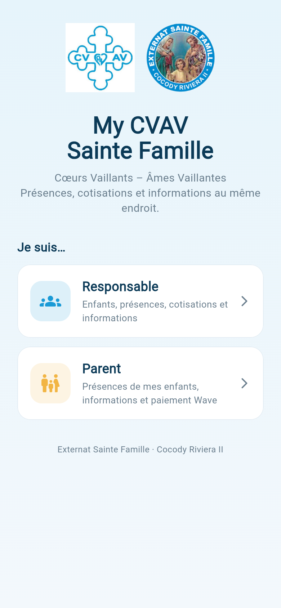
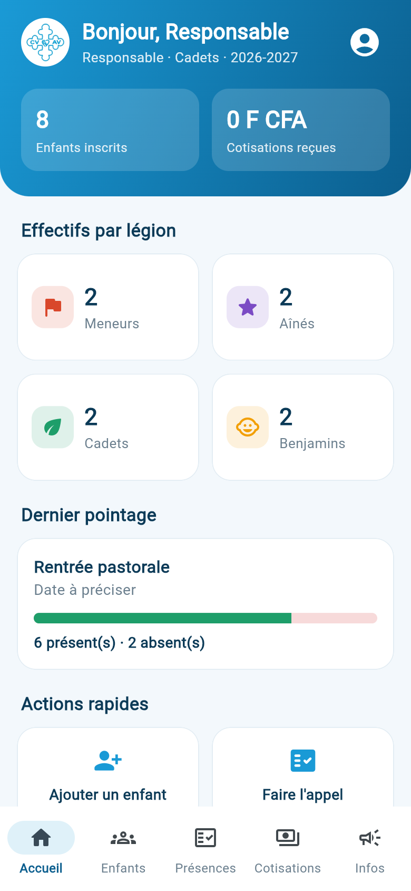

# My CVAV Sainte Famille

Application Android (APK) des **Cœurs Vaillants – Âmes Vaillantes** de l'Externat Sainte Famille (Cocody Riviera II) :
liste des enfants par légion, appel aux activités et réunions, cotisations, informations, et paiement par **Wave**.

| Accueil | Espace responsable | Espace parent |
|---|---|---|
|  |  |  |

```
cvav/
├── app/        Application Flutter (Android ; version web possible)
├── backend/    API REST Node.js + PostgreSQL
├── docs/       Architecture, API, sécurité, parcours et captures
├── backend/vercel.json  Hébergement de l'API sur Vercel (base Neon)
└── .github/workflows/build-apk.yml  Tests + compilation automatique de l'APK
```

## Fonctionnalités

**Responsable** (inscription protégée par un code d'accès)
- **Enfants** : nom, prénoms, âge ou date de naissance, contact et nom des parents, lieu d'habitation, répartis en
  **Meneurs, Aînés, Cadets, Benjamins**. Recherche, fiche détaillée, appel ou WhatsApp au parent.
- **Import de liste** depuis **Word (.docx), PDF, Excel (.xlsx) ou CSV**. L'application reconnaît les colonnes usuelles
  (« Nom », « Prénoms », « Âge », « Date de naissance », « Contact des parents », « Lieu d'habitation », « Légion ») et les
  titres de section (« Légion des Cadets »…). Un **aperçu modifiable** est affiché avant l'enregistrement, les doublons sont signalés.
- **Présences** : les 7 activités de l'année sont créées automatiquement (Rentrée pastorale, Accueil des nouveaux,
  Camp de jumelage, Happy New Year, Ressourcement spirituel, Cérémonie d'ascension personnelle, Mini camp biblique +
  Journée sportive) ; on ajoute les réunions. Appel par légion, boutons P / A, « restants présents », nom du responsable qui a pointé.
- **Cotisations** : paroissiale (1 500 F par défaut), diocésaine (montant à fixer), activités (prix fixé par activité).
  Liste des enfants par légion, on coche ceux qui ont payé. Les paiements Wave déclarés par les parents sont mis en évidence pour confirmation.
- **Informations** : publication, épinglage, modification et suppression d'annonces lues par les parents.

**Parent**
- Rattache ses enfants avec le **code enfant** (8 caractères) donné par le responsable.
- **Présences et absences** de ses enfants, par ordre alphabétique, avec taux d'assiduité.
- **Informations** : annonces et **cotisations à payer** (montant, type, activité), bouton **PAYER LA COTISATION**
  qui ouvre **Wave** avec le montant.

## Démarrage rapide (développement)

Prérequis : Node.js 20+, PostgreSQL 14+, Flutter 3.47+.

```bash
# API
cd backend
cp .env.example .env          # renseigner DATABASE_URL, JWT_SECRET, RESPONSABLE_SIGNUP_CODE
npm install
npm run seed                  # données de démo (facultatif)
npm run dev                   # http://localhost:3000/api/health
npm test                      # 20 tests d'intégration (base cvav_test)

# Application
cd ../app
flutter pub get
flutter run --dart-define=API_URL=http://10.0.2.2:3000   # émulateur Android
```

Comptes de démo créés par `npm run seed` en local uniquement : responsable `0700000001`, parent `0700000002`,
mot de passe `cvav2026`. La base en ligne est vide : le premier responsable crée son compte avec le code d'accès.

## Obtenir l'APK

### Option 1 : GitHub Actions (recommandée, aucun outil à installer)
1. Créez un dépôt GitHub et poussez ce dossier.
2. Dans *Settings → Secrets and variables → Actions → Variables*, ajoutez `API_URL` = l'adresse de votre API déployée.
3. Onglet *Actions → Tests et APK → Run workflow*. À la fin, téléchargez l'artefact **my-cvav-sainte-famille-apk**.
4. Pour une version à distribuer, créez une clé de signature (une seule fois, à conserver précieusement) :
   ```bash
   keytool -genkey -v -keystore cvav.jks -keyalg RSA -keysize 2048 -validity 10000 -alias cvav
   base64 -w0 cvav.jks   # contenu du secret ANDROID_KEYSTORE_BASE64
   ```
   puis ajoutez les secrets `ANDROID_KEYSTORE_BASE64`, `ANDROID_KEYSTORE_PASSWORD`, `ANDROID_KEY_ALIAS`, `ANDROID_KEY_PASSWORD`.
   Un tag `v1.0.0` publie l'APK dans *Releases*.

### Option 2 : sur votre ordinateur (Android Studio installé)
```bash
cd app
flutter build apk --release --dart-define=API_URL=https://votre-api.exemple.com
# -> app/build/app/outputs/flutter-apk/app-release.apk
```

L'adresse de l'API peut aussi être changée dans l'application : **appui long sur le logo CVAV** de l'écran d'accueil.

## Hébergement (en ligne, gratuit)

| Élément | Service | Détail |
|---|---|---|
| API | **Vercel** (offre Hobby gratuite) | `https://my-cvav-sainte-famille-api-mamadoudibate-5976.vercel.app` — fonctions à Francfort (`fra1`) |
| Base de données | **Neon** (offre gratuite, sans expiration) | PostgreSQL 17, projet `my-cvav-sainte-famille`, région Francfort, 0,5 Go |

- Les migrations s'appliquent automatiquement au premier appel de l'API.
- L'application est déjà configurée sur cette adresse (`app/lib/config.dart`).
- Les secrets (`DATABASE_URL`, `JWT_SECRET`, `RESPONSABLE_SIGNUP_CODE`) sont dans *Vercel → Projet → Settings → Environment Variables*, jamais dans le code.
- Après toute modification d'une variable sur Vercel : *Deployments → ⋯ → Redeploy*.
- Limites gratuites : Neon met la base en veille après 5 min d'inactivité (premier appel ≈ 1 s de plus) ; Vercel Hobby est réservé à un usage non commercial, ce qui convient à une association paroissiale.
- Redéployer depuis un ordinateur : `cd backend && npx vercel --prod`. Alternative auto-hébergée : `backend/Dockerfile`.

## Mot de passe oublié (SMS)

L'écran « Mot de passe oublié ? » envoie un code à 6 chiffres par SMS (valable 10 min, 5 essais, 3 demandes/heure).
Il faut un fournisseur SMS ; sans lui, l'application affiche « envoi de SMS pas encore configuré ».

**Orange SMS API (recommandé en Côte d'Ivoire)** : créer un compte sur developer.orange.com, une application avec
l'API « SMS Côte d'Ivoire », acheter un forfait de SMS, puis ajouter sur Vercel :
`SMS_PROVIDER=orange`, `ORANGE_CLIENT_ID`, `ORANGE_CLIENT_SECRET`, `ORANGE_SENDER_ADDRESS=tel:+2250000`,
et facultativement `SMS_SENDER_NAME=CVAV` (nom d'expéditeur à faire valider par Orange).
Twilio est aussi pris en charge (`SMS_PROVIDER=twilio`, `TWILIO_ACCOUNT_SID`, `TWILIO_AUTH_TOKEN`, `TWILIO_FROM`).

## Paiement Wave (Wave Business — Checkout API)

1. Ouvrir un compte **Wave Business** pour l'association et demander l'accès API (business.wave.com → Développeurs).
2. Créer une **clé API** avec le droit *Checkout* et un **webhook** vers
   `https://my-cvav-sainte-famille-api-mamadoudibate-5976.vercel.app/api/payments/wave/webhook`
   (événement `checkout.session.completed`, signature par secret partagé).
3. Ajouter sur Vercel `WAVE_API_KEY` et `WAVE_WEBHOOK_SECRET`, puis *Redeploy*.

Le parent touche **PAYER LA COTISATION** → l'API crée une session au bon montant → Wave s'ouvre → le webhook signé
marque automatiquement la cotisation comme payée. Tant que les clés ne sont pas ajoutées, le bouton indique que le
paiement Wave n'est pas encore configuré. (Un mode « lien marchand » existe aussi : `WAVE_MERCHANT_LINK`.)

## Documentation

- [Architecture, modèle de données et API](docs/ARCHITECTURE.md)
- [Sécurité](docs/SECURITE.md)
- [Parcours utilisateurs et écrans](docs/PARCOURS.md)
