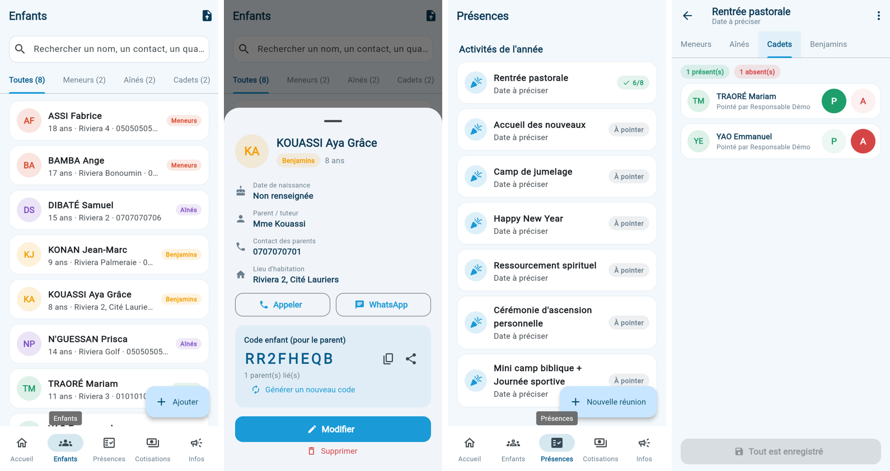
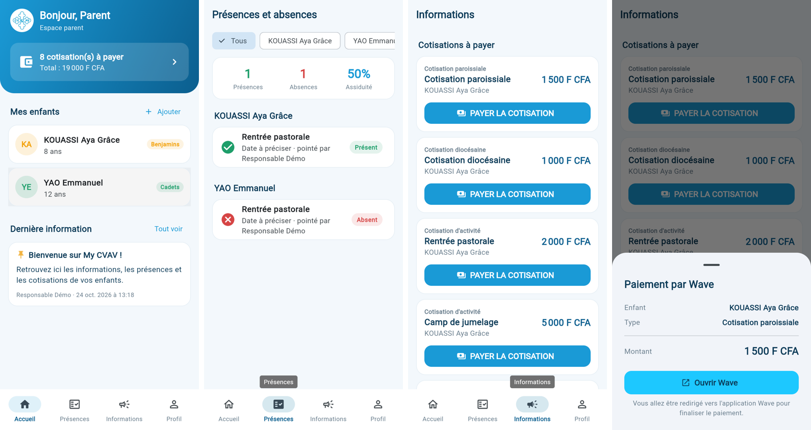

# Parcours utilisateurs et écrans

## Premier lancement
1. **Accueil** : logos CVAV et Sainte Famille, choix « Responsable » ou « Parent ».
2. **Connexion / Créer un compte** (onglets). Identifiant : numéro de téléphone (formats `07 00 00 00 00`,
   `+225…` acceptés).
   - Responsable : nom, téléphone, légion, **code d'accès responsable**, mot de passe.
   - Parent : nom, téléphone, mot de passe.

## Responsable — barre du bas : Accueil · Enfants · Présences · Cotisations · Infos

**Accueil** : effectif total et par légion, total des cotisations reçues, paiements Wave à confirmer, dernier
pointage (barre présents/absents), actions rapides.

**Enfants**
- Recherche (nom, contact, quartier) et onglets *Toutes / Meneurs / Aînés / Cadets / Benjamins* avec effectifs.
- Bouton **Ajouter** → *Saisie manuelle* ou *Importer une liste*.
- **Fiche enfant** : âge, parent, contact, lieu d'habitation ; boutons **Appeler** et **WhatsApp** ; **code enfant**
  à copier ou partager (message prêt à envoyer au parent) ; modifier ; supprimer.
- **Import** : choisir le fichier → liste des enfants reconnus (légion, alertes « Légion déduite de l'âge »,
  « Déjà inscrit ») → corriger une ligne d'un toucher, décocher les lignes à ignorer → *Ajouter N enfant(s)*.

**Présences**
- *Activités de l'année* (7 activités prévues) et *Réunions* (bouton « Nouvelle réunion », date du jour par défaut).
- **Feuille d'appel** : onglets par légion, boutons **P** / **A** (un second appui efface), « Restants présents »,
  compteur, bouton *Enregistrer (N)*. Menu ⋮ : modifier l'intitulé/la date, supprimer.

**Cotisations**
- Total encaissé, puis trois cartes :
  - **Cotisation paroissiale** (1 500 F) et **Cotisation diocésaine** → liste par légion, cases à cocher pour les
    enfants ayant payé, ✏️ pour changer le montant. Mentions « Paiement Wave déclaré — cochez pour confirmer » et
    « Payé via Wave ».
  - **Cotisation des activités** → activités de l'année avec leur prix (*Fixer le prix*), bouton « Activité » pour en
    ajouter une ; un toucher ouvre la liste de cochage de l'activité.

**Infos** : liste des annonces (épinglées en premier), *Publier*, modifier, supprimer.

**Profil** (icône en haut de l'accueil) : changer le mot de passe, à propos, déconnexion.

## Parent — barre du bas : Accueil · Présences · Informations · Profil

**Accueil** : nombre et total des cotisations à payer, **Mes enfants** (+ *Ajouter* avec le code enfant ; appui long
pour retirer), dernière information.

**Présences** : pour chaque enfant (ordre alphabétique), la liste des activités/réunions avec **Présent** / **Absent**,
la date et le responsable qui a pointé ; filtre par enfant ; compteurs et taux d'assiduité.

**Informations**
1. **Cotisations à payer** : carte par cotisation (type, activité, enfant, montant) et bouton **PAYER LA COTISATION**.
2. Récapitulatif (enfant, type, activité, montant) → **Ouvrir Wave**.
3. Paiement dans Wave, retour dans l'app :
   - Wave Business : la cotisation passe en « Déjà payées » dès réception du webhook.
   - Lien marchand : « Paiement effectué ? » → *Oui, j'ai payé* (n° de transaction facultatif) → « en attente de
     confirmation » jusqu'à validation d'un responsable.
4. **Annonces** des responsables.

## États gérés partout
Chargement, liste vide avec action proposée, erreur réseau avec *Réessayer*, session expirée (retour à l'accueil avec
message), modifications non enregistrées (confirmation avant de quitter).
